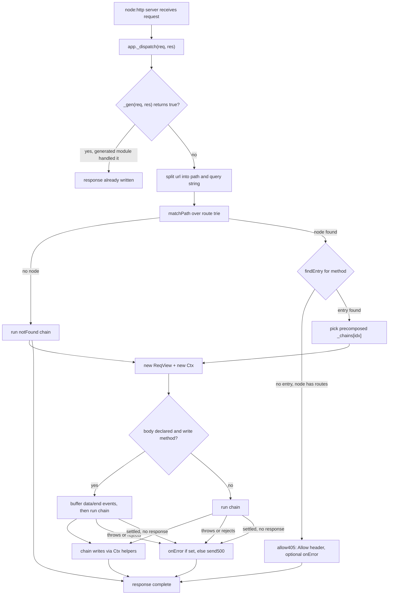

# chttp architecture

chttp is a minimal HTTP router for `node:http`, async-first. The package has zero runtime dependencies and is authored in the scriptc-compilable subset of TypeScript, so `scriptc build` can statically lower the whole package into a native binary. Routes are registered on an `App`, matched against a trie at request time, and handled by a chain of middleware plus one handler that writes the response through `Ctx` helpers. Handlers and middleware may return promises: dispatch awaits a non-sett...

## Request flow

A request enters through the `node:http` listener created by `app.serve()` or `app.handler()`. The listener calls `app._dispatch`, which first offers the request to the registered generated dispatch module (the build-time seam), then splits `req.url` into path and query string, matches the path against the route trie, picks the entry for the method, and runs the precomposed chain for that entry. `Ctx` helpers (`text`, `json`, `html`, `redirect`) set status, headers, and content length, then...

## Module layout

| Module                      | Role                                                                                                                                            |
| --------------------------- | ----------------------------------------------------------------------------------------------------------------------------------------------- |
| `packages/router/src/index.ts` | The whole core: `App`, `Ctx`, `ReqView`, `compose`, `matchPath`, `addRoute`, error path, exported `createRouter()` factory                      |
| `packages/router/src/gen.ts`   | The `GenDispatch` base class and `DispatchFn` type, the interface between runtime dispatch and build-generated route modules                    |
| `packages/unplugin/src`     | Build-time plugin: extracts the literal route table from `*.chttp.ts` modules and emits a `routes.gen.ts` that satisfies `contracts/route-contract.md` |

Inside `packages/router/src/index.ts`:

- `ReqView` (line 37) is a read view over `IncomingMessage`: method, path, query, headers, body. Param and query tables materialize lazily; dispatch skips param work entirely for handlers that never read them.
- `Ctx` (line 213) wraps `ReqView` plus `ServerResponse` and exposes the response-writing helpers. `sent` records whether a body-carrying helper already flushed, which the error path consults.
- The route table is a trie of plain records (`RouteNode`, line 325). Node kinds: 0 static, 1 `:param`, 2 `*` wildcard. Handlers never live in the records; `hf` stores indices into `App._fns` and parallel class-side arrays (`_mws`, `_chains`, `_pn`, `_pi`, `_sp`, `_bodyF`) hold per-entry metadata.
- `matchPath` (line 431) does zero-allocation matching over the raw path with `charCodeAt` segment bounds. A static-only fast descent runs first; on a miss it hands off to a depth-first search over an explicit frame stack (no recursion). Children are visited wildcard, param, then static, so static segments win.
- `findEntry` (line 503) resolves the method against the matched node's method table, with `*` (all) and HEAD-falls-back-to-GET support.
- `App._dispatch` (line 964) is the request entry described above.
- `runOnError` (line 1039) and `send500` (line 639) hold the error path.

## Route registration and the compose model

Verb methods (`get`, `post`, `put`, `delete`, `patch`, `head`, `options`, `all`, `on`) all funnel into `App._add`, which registers the handler via `_regFn` and inserts the path into the trie via `addRoute`. `app.use(fn)` pushes a middleware onto the app-level list; a route registers a snapshot of the current list, so middleware added after a route does not affect it. `app.route(prefix, subApp)` flattens a sub-app's trie into the parent under a prefix, merging the parent's current middleware...

Each registered entry is composed exactly once, at registration time: `compose(mw, handler)` folds the middleware snapshot and handler into one `Handler` stored in `_chains[i]`. Dispatch calls that function directly. There is no runtime chain walker and no per-request closure allocation. The semantics are linear koan-style: `next()` resumes the tail, and a middleware that calls `next()` twice re-runs the tail twice.

Route paths support static segments, `:name` params, and a trailing `*` wildcard splat. Param names and segment positions are extracted once at registration (`pathMeta`) and bound to the `ReqView` at dispatch. Values are decoded and materialized only on the first `param()` or splat read.

Match results are not memoized in a cache object. The memoization is structural. The per-entry chain, middleware snapshot, param metadata, and body flag are all computed once during `_regFn`. Each request pays only for the trie walk, one method lookup, and one prebuilt array access.

## Body handling

Bodies are opt-in per route: `app.post('/x', h, { body: true })`. Only then, and only for write methods (POST, PUT, PATCH, DELETE), does dispatch attach `data`/`end` listeners, buffer chunks via string concatenation, set the body on `ReqView`, and run the chain from the `end` callback. Without the flag, `c.req.body()` returns `''`.

## Error path

Every chain invocation goes through `runChain`: one `try`/`catch` for the synchronous path, plus `await` settlement inside `settleChain` when the chain result is not already settled (`undefined`/`null`/`c` are; everything else, in practice promises, is not). Throws and rejections reach `runOnError` through the same code. A settled chain that never wrote a response gets the built-in 500 fallback.

On an error, `runOnError` applies this order:

1. If headers were already sent, the socket is destroyed (nothing sane to write); otherwise the user `onError(err, c)` runs, if registered.
1. If the handler answered (checked via `Ctx.sent`), dispatch stops there.
1. If it did not answer, the built-in `send500` writes a plain-text 500.
1. Anything thrown inside `onError` falls back to `send500` too, so a request always gets exactly one terminal outcome and the error handler cannot loop.

A path match whose method misses goes through `allow405` instead: a 405 with an `Allow` header built from the node's registered methods (`*` expands to every standard verb, GET implies HEAD). If an `onError` is registered it first gets a synthetic `Ctx` wrapping the real request so it can answer custom 405s.

## Response sink and the two surfaces

`Ctx` writes through a `ResponseSink` rather than directly to a `ServerResponse`. The sink has two concrete subclasses:

- `NodeResponseSink` (`packages/router/src/sink.ts`) wraps a real `node:http` `ServerResponse`. `setStatus`, `setHeader`, `appendHeader`, `body` map one-to-one to the underlying socket. This is the path the `app.handler()` adapter uses.
- `FetchResponseSink` captures into a `{status, headers: Headers, chunks: Uint8Array[]}` record. `app.fetch()` finalizes the sink by constructing a `new Response(stream, init)` from the captured chunks, so the same chain code produces a spec-compliant Web `Response` that the Workerd / Deno Deploy / Bun / Vercel Edge / Service Worker / Lambda @edge runtime can serialize and ship.

The two sinks share a `ResponseSink` base class with `setStatus`, `setHeader`, `appendHeader`, `body`, `redirect`, `isSent`, and `finalize`. `Ctx` holds the sink; `c.text`, `c.json`, `c.html`, `c.bytes`, `c.header`, `c.redirect`, `c.status` all dispatch through it. Handlers and middleware never see `ServerResponse` or `Response` directly except via `c.req.raw` (the inbound `Request`) and the optional `c.res` getter (the outbound platform object: `ServerResponse` on the Node path, a `Response`-shaped view on the fetch path).

`app.handler()` is a ~60 LOC Node adapter that synthesizes a `Request` from the inbound `IncomingMessage` (path, method, query, headers, buffered body) and a `NodeResponseSink` over the `ServerResponse`, then awaits `app._runSink(req, sink)`. `app.fetch(req, env?, ctx?)` is the canonical entry — the same `createRouter()` symbol works on Node, every Workers / Edge runtime, and as a Service Worker.

`@chttp/stream` writes through the same sink. On the Node path chunks flush straight to the socket; on the fetch path they collect into a `ReadableStream` that the runtime pulls lazily. Streaming parity is covered by the standard `pnpm test` suite plus the `chttp-fetch` scriptc gate (`bench/apps/chttp-fetch.ts`, 100% static coverage).

Generated dispatch (`@chttp/unplugin`) still emits a `NodeResponseSink`-shaped class — the build-time seam is Node-shaped and unchanged. The fetch path synthesizes a `Request` plus a `NodeResponseSink` and intercepts `finalize()` to produce the `Response`. A follow-up issue proposes a parallel Web-Standards-shaped emitter (`GenFetch`); it's not required for the surface contract.

## scriptc compilation

chttp's source is written inside the scriptc-compilable subset so `scriptc build` lowers it to a native binary. The constraints that force the code into its current shape:

- The only async function in the package is `settleChain`, the fire-and-forget settler called when a chain result is not already settled. Promises cannot be detected directly in the subset: reading `.then` as a value refuses (SC1090; in expression position it silently lowers to `undefined`), `instanceof Promise` is refused, and a union mixing `Promise` and non-Promise arms refuses (SC2009). `await` is the one narrowing left: it passthroughs non-thenables and joins real promises, so the disc...
- `| null` unions only, never `| undefined`.
- No `Map`, `Set`, `Object.create(null)`, or `Object.freeze`; plain record literals with full shapes.
- Indexed `for` loops only; `.pop()` as a statement, never an expression.
- No `?.` / `??`, no object or method shorthand in literals, no spread, no `eval` / `new Function`.
- No function values inside records: handlers and middleware snapshots live in parallel arrays on the `App` class, and trie nodes store numeric indices. Function-typed record fields degrade instantiation to `unknown` and fence every call site.
- No recursion for matching: `matchPath` and `mountRoutes` use explicit frame stacks, because recursive calls monomorphize an `unknown` instantiation.
- `String(x)` / `Number(x)` coercion at function entry for parameters that arrive `unknown`.
- Bodies are read with `req.on('data' | 'end')` plus string concatenation. `Buffer.concat(Buffer[])` does lower.

The `GenDispatch` seam (`packages/router/src/gen.ts`) is a base class whose default `dispatch` returns `false`. The unplugin emits a `class CompiledRoutes extends GenDispatch` from the extracted route table and the app registers it with `app.withDispatch(...)`. `_dispatch` offers every request to that module first, so generated code can dispatch literal routes directly (seeding pre-materialized param pairs via `ReqView._seedPm`) and bypass the general trie entirely. The unplugin is delibera...

Reference documents:

- `contracts/route-contract.md` is the frozen contract for generated dispatch modules: emitted class shape, param seeding, body flag handling, and error behavior.
- `docs/unplugin.md` documents the build-time plugin: extraction rules, the module model, and the emitted code shape.
