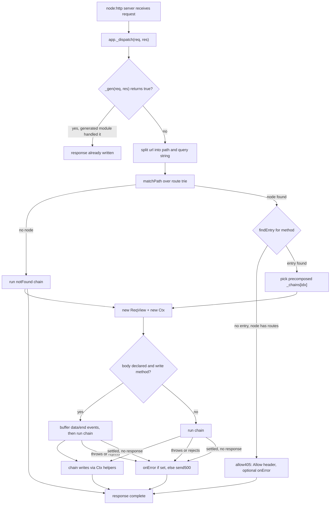

# ch3 architecture

ch3 is a minimal HTTP router for `node:http`, async-first. The package has zero
runtime dependencies and is authored in the scriptc-compilable subset of
TypeScript, so `scriptc build` can statically lower the whole package into a
native binary. Routes are registered on an `App`, matched against a trie at
request time, and handled by a chain of middleware plus one handler that
writes the response through `Ctx` helpers. Handlers and middleware may return
promises — dispatch awaits a non-settled chain result inside `settleChain`, a
fire-and-forget async helper — while synchronous handlers keep a
zero-microtask fast path (one return slot, three identity compares).

## Request flow

A request enters through the `node:http` listener created by `app.serve()` or
`app.handler()`. The listener calls `app._dispatch`, which first offers the
request to the registered generated dispatch module (the build-time seam), then
splits `req.url` into path and query string, matches the path against the route
trie, picks the entry for the method, and runs the precomposed chain for that
entry. `Ctx` helpers (`text`, `json`, `html`, `redirect`) set status, headers,
and content length, then call `res.end()`. When the chain returns something
that is not already settled (`undefined`, `null`, or the `c` object that
response helpers hand back), dispatch awaits it in `settleChain`: a fulfilled
result that never wrote a response and a rejection both fall into the error
path below.

## Module layout

| Module | Role |
| --- | --- |
| `packages/ch3/src/index.ts` | The whole core: `App`, `Ctx`, `ReqView`, `compose`, `matchPath`, `addRoute`, error path, exported `createRouter()` factory |
| `packages/ch3/src/gen.ts` | The `GenDispatch` base class and `DispatchFn` type, the seam between runtime dispatch and build-generated route modules |
| `packages/ch3/src/unplugin` | Build-time plugin: extracts the literal route table from `*.ch3.ts` modules and emits a `routes.gen.ts` that satisfies `docs/route-contract.md` |

Inside `packages/ch3/src/index.ts`:

- `ReqView` (line 37) is a read view over `IncomingMessage`: method, path,
  query, headers, body. Param and query tables materialize lazily; dispatch
  does zero param work for handlers that never read them.
- `Ctx` (line 213) wraps `ReqView` plus `ServerResponse` and exposes the
  response-writing helpers. `sent` records whether a body-carrying helper
  already flushed, which the error path consults.
- The route table is a trie of plain records (`RouteNode`, line 325). Node
  kinds: 0 static, 1 `:param`, 2 `*` wildcard. Handlers never live in the
  records; `hf` stores indices into `App._fns` and parallel class-side arrays
  (`_mws`, `_chains`, `_pn`, `_pi`, `_sp`, `_bodyF`) hold per-entry metadata.
- `matchPath` (line 431) does zero-allocation matching over the raw path with
  `charCodeAt` segment bounds. A static-only fast descent runs first; on a
  miss it hands off to a depth-first search over an explicit frame stack
  (no recursion). Children are visited wildcard, param, then static, so
  static segments win.
- `findEntry` (line 503) resolves the method against the matched node's
  method table, with `*` (all) and HEAD-falls-back-to-GET support.
- `App._dispatch` (line 964) is the request entry described above.
- The error path lives in `runOnError` (line 1039) and `send500` (line 639).

## Route registration and the compose model

Verb methods (`get`, `post`, `put`, `delete`, `patch`, `head`, `options`,
`all`, `on`) all funnel into `App._add`, which registers the handler via
`_regFn` and inserts the path into the trie via `addRoute`. `app.use(fn)`
pushes a middleware onto the app-level list; a route registers a snapshot of
the current list, so middleware added after a route does not affect it.
`app.route(prefix, subApp)` flattens a sub-app's trie into the parent under a
prefix, merging the parent's current middleware in front of each sub-route's
snapshot.

Each registered entry is composed exactly once, at registration time:
`compose(mw, handler)` folds the middleware snapshot and handler into a single
`Handler` stored in `_chains[i]`. Dispatch calls that one function directly;
there is no runtime chain walker and no per-request closure allocation. The
semantics are linear koan-style: `next()` resumes the tail, and a middleware
that calls `next()` twice re-runs the tail twice.

Route paths support static segments, `:name` params, and a trailing `*`
wildcard splat. Param names and segment positions are extracted once at
registration (`pathMeta`) and bound to the `ReqView` at dispatch; values are
decoded and materialized only on the first `param()` or splat read.

Match results are not memoized in a cache object; the memoization is structural.
The per-entry chain, middleware snapshot, param metadata, and body flag are all
computed once during `_regFn`, so the per-request work reduces to the trie walk,
one method lookup, and one prebuilt array access.

## Body handling

Bodies are opt-in per route: `app.post('/x', h, { body: true })`. Only then,
and only for write methods (POST, PUT, PATCH, DELETE), does dispatch attach
`data`/`end` listeners, buffer chunks via string concatenation, set the body on
`ReqView`, and run the chain from the `end` callback. Without the flag,
`c.req.body()` returns `''`.

## Error path

Every chain invocation goes through `runChain`: one `try`/`catch` for the
synchronous path, plus `await` settlement inside `settleChain` when the chain
result is not already settled (`undefined`/`null`/`c` are — everything else,
in practice promises, is not). Throws and rejections land on `runOnError` the
same way; a settled chain that never wrote a response gets the built-in 500
fallback.

On an error, `runOnError` applies this order:

1. If headers were already sent, the socket is destroyed (nothing sane to
   write); otherwise the user `onError(err, c)` runs, if registered.
2. If the handler answered (checked via `Ctx.sent`), dispatch stops there.
3. If it did not answer, the built-in `send500` writes a plain-text 500.
4. Anything thrown inside `onError` falls back to `send500` too, so a request
   always gets exactly one terminal outcome and the error handler cannot loop.

A path match whose method misses goes through `allow405` instead: a 405 with an
`Allow` header built from the node's registered methods (`*` expands to every
standard verb, GET implies HEAD). If an `onError` is registered it first gets a
synthetic `Ctx` wrapping the real request so it can answer custom 405s.

## scriptc compilation

ch3's source is written inside the scriptc-compilable subset so `scriptc
build` lowers it to a native binary. The constraints that shape the code:

- The only async function in the package is `settleChain`, the fire-and-forget
  settler called when a chain result is not already settled. Promises cannot
  be detected directly in the subset: reading `.then` as a value refuses
  (SC1090 — and in expression position silently lowers to `undefined`),
  `instanceof Promise` is refused, and a union mixing `Promise` and
  non-Promise arms refuses (SC2009). `await` is the one narrowing left — it
  passthroughs non-thenables and joins real promises, so the discriminator is
  the identity check `r === undefined || r === null || r === c` plus `await`
  for everything else. Sync-complete returns therefore keep a zero-microtask
  path while async handlers get full settle semantics.
- `| null` unions only, never `| undefined`.
- No `Map`, `Set`, `Object.create(null)`, or `Object.freeze`; plain record
  literals with full shapes.
- Indexed `for` loops only; `.pop()` as a statement, never an expression.
- No `?.` / `??`, no object or method shorthand in literals, no spread, no
  `eval` / `new Function`.
- No function values inside records: handlers and middleware snapshots live in
  parallel arrays on the `App` class, and trie nodes store numeric indices.
  Function-typed record fields degrade instantiation to `unknown` and fence
  every call site.
- No recursion for matching: `matchPath` and `mountRoutes` use explicit frame
  stacks, because recursive calls monomorphize an `unknown` instantiation.
- `String(x)` / `Number(x)` coercion at function entry for parameters that
  arrive `unknown`.
- Bodies are read with `req.on('data' | 'end')` plus string concatenation;
  `Buffer.concat` is not lowered.

The `GenDispatch` seam (`packages/ch3/src/gen.ts`) is a base class whose
default `dispatch` returns `false`. The unplugin emits a
`class CompiledRoutes extends GenDispatch` from the extracted route table and
the app registers it with `app.withDispatch(...)`. `_dispatch` offers every
request to that module first, so generated code can dispatch literal routes
directly (seeding pre-materialized param pairs via `ReqView._seedPm`) and
bypass the general trie entirely. The unplugin is deliberately deterministic
and positional: only top-level registrations with compile-time literal paths
count, everything else stays on the runtime router with a warning.

Reference documents:

- `docs/route-contract.md` is the frozen contract for generated dispatch
  modules: emitted class shape, param seeding, body flag handling, and error
  behavior.
- `docs/unplugin.md` documents the build-time plugin: extraction rules, the
  module model, and the emitted code shape.
